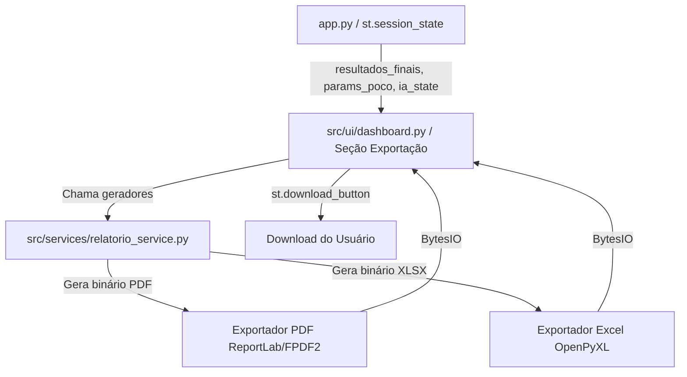
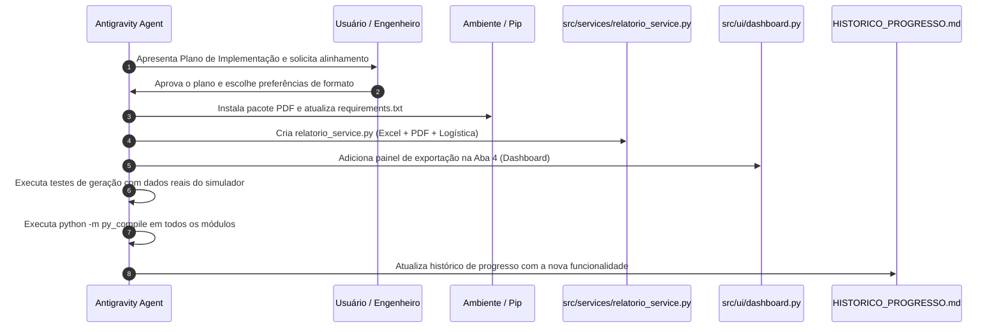

# 📋 Plano de Implementação: Módulo de Exportação de Relatórios de Cimentação
## Memorial Descritivo Operacional & Fichas de Traço (Rig Batch Sheets)

---

### 1. 🎯 Objetivo da Funcionalidade

Disponibilizar ao engenheiro de poço e ao operador de sonda a capacidade de exportar um **Memorial Descritivo e Operacional Completo** da operação de cimentação planejada no simulador, contendo:
1. **Dados de Identificação & Parâmetros do Poço** (Geometria, Revestimento, Sapata, Lama de Perfuração e Janela Geomecânica).
2. **Quadro Resumo Hidráulico e Volumétrico** (Cubagem total, EMW, Pressão Hidrostática no fundo, Rendimentos e Volume em barris/sacos).
3. **Fichas de Traço Operacional (*Batch Sheets*)** para cada pasta (Lead Slurry e Tail Slurry), detalhando dosagens (% BWOC ou gal/sk), massas e volumes unitários e totais por componente (Cimento, Água e Aditivos químicos).
4. **Resumo Logístico de Materiais** (Total de sacos de cimento, toneladas métricas, volume de água de amassamento em bbl e $m^3$, e estoque requerido de cada aditivo).
5. **Auditoria Geomecânica e Parecer Técnico do Especialista de IA** (Groq LPU ou Ollama Local com conformidade nos guardrails determinísticos da API Spec 10A/10B e Bourgoyne et al.).

---

### 2. 📑 Formatos de Exportação Propostos

Para atender tanto à formalidade documental quanto à operação prática em sonda, propomos uma solução híbrida:

| Formato | Finalidade Principal | Tecnologia | Características |
| :--- | :--- | :--- | :--- |
| **📄 PDF Executivo de Engenharia** | Documento oficial para auditoria, arquivo de poço, assinatura de técnicos e apresentação acadêmica/gerencial. | `reportlab` ou `fpdf2` | Diagramação estilo A4 formal, cabeçalho industrial (OpenLab/Poli-USP), tabelas limpas de pesagem de sonda e rodapé com timestamp normativo. |
| **📊 Planilha Técnica Excel (.xlsx)** | Uso operacional em sonda, planejamento logístico e integração com outros softwares de engenharia. | `openpyxl` (já instalado no ambiente) | Múltiplas abas: `Resumo_Executivo`, `Geometria_Poco`, `Quadro_Pastas`, `Ficha_Traco_Tail`, `Ficha_Traco_Lead`, `Logistica_Materiais`. Fórmulas de totalização ativas. |
| **🖨️ Pré-visualização & Impressão Direta (Web)** | Visualização instantânea sem necessidade de download prévio. | Streamlit Dialog / HTML/CSS | Modal na tela com botão direto para visualização e atalho de impressão rápida (`Ctrl+P`). |

---

### 3. 🏛️ Arquitetura de Software Proposta

Seguindo os padrões estritos de modularidade do projeto (`src/services/` e `src/ui/`):

#### Arquivos Envolvidos:
- **`src/services/relatorio_service.py` (Novo)**:
  - Centraliza a lógica de geração dos relatórios (sem acoplamento direto com a UI).
  - Método `gerar_relatorio_excel(params_poco, resultados_finais, dados_ia) -> io.BytesIO`
  - Método `gerar_relatorio_pdf(params_poco, resultados_finais, dados_ia) -> io.BytesIO`
  - Método `montar_resumo_logistico(resultados_finais) -> Dict[str, Any]`
- **`src/ui/dashboard.py` (Modificado)**:
  - Adição de uma nova seção dedicada de exportação: *"📄 Exportação do Memorial Descritivo da Operação"*.
  - Botões elegantes de download: `📥 Baixar Memorial Descritivo (PDF)` e `📊 Baixar Planilha Operacional (Excel)`.
  - Opção de incluir/excluir o parecer do Agente de IA no relatório.
- **`requirements.txt` (Modificado)**:
  - Adicionar a biblioteca de PDF escolhida (`reportlab` ou `fpdf2`). `openpyxl` já é compatível.
- **`HISTORICO_PROGRESSO.md` (Atualizado ao final)**:
  - Registro de todas as mudanças, testes e status.

---

### 4. 📝 Estrutura de Conteúdo do Relatório

O relatório conterá 5 seções bem delineadas:

#### Seção 1: Cabeçalho & Metadados Operacionais
- Nome do Poço / Operação (editável na UI ou com valor padrão ex: `POÇO-USP-CIM-01`).
- Data/Hora de Geração, Responsável Técnico, Campo/Bacia.
- Normas de Referência: API Spec 10A, API RP 10B, Bourgoyne et al. (Cap. 3).

#### Seção 2: Geometria do Poço & Condições de Fundo
- Diâmetro da Broca ($D_{bit}$), Diâmetros do Revestimento ($OD$ e $ID$).
- Fator de Excesso de Cimento ($E\%$).
- Sapata e Colar Flutuante (Comprimento do Shoe Track).
- Densidade da Lama de Perfuração ($\rho_{lama}$), Gradiente de Poro e Gradiente de Fratura.
- Temperaturas BHST e BHCT.

#### Seção 3: Resumo Volumétrico & Balanço de Pressões
- Tabela comparativa de todas as pastas configuradas (Lead, Tail, etc.):
  - Classe API do Cimento (G, H, A...).
  - Topo, Base e Comprimento da Coluna ($ft$).
  - Rendimento da Pasta ($ft^3/sk$) e Água de Amassamento ($gal/sk$).
  - Volume Total em $ft^3$ e $bbl$.
  - Quantidade de Sacos ($sk$) e Massa de Cimento ($lb$ e $t$ métricas).
  - Densidade da Pasta ($ppg$).
  - Pressão Hidrostática Parcial ($psi$).
- Totalizadores do Poço: Volume Total ($bbl$), Sacos Totais ($sk$), Pressão Total no Fundo ($psi$), Densidade Média Equivalente ($EMW$).

#### Seção 4: Fichas de Traço Operacional (*Batch Sheets*)
Para cada pasta configurada, uma tabela de pesagem detalhada:
- Lista de componentes: Cimento Base, Água de Amassamento, Aditivos Químicos (Retardador, Dispersante, Redutor de Filtrado, etc.).
- Dosagem (% BWOC ou gal/sk).
- Volume Unitário ($gal/sk$) e Massa Unitária ($lb/sk$).
- Massa Total Requerida ($lb$ e $kg$).
- Volume Total Requerido ($gal$ e $bbl$).

#### Seção 5: Auditoria Geomecânica & Parecer do Especialista de IA
- Checagem determinística da janela operacional:
  - Overbalance: Confirmação de que $P_{hid} > P_{poro}$.
  - Fratura: Confirmação de que $EMW < Grad_{fratura}$.
  - Contraste de densidades para deslocamento eficiente: $\rho_{lama} < \rho_{lead} \le \rho_{tail}$.
- Parecer Técnico emitido pelo Agente Especialista (se executado na sessão), com análise de viscosidade, controle de filtrado, risco de gás e tempo de espessamento.

---

### 5. 🛠️ Etapas de Execução Passo a Passo

1. **Etapa 1 — Configuração de Dependências:**
   - Adicionar `reportlab` (ou `fpdf2`) ao `requirements.txt`.
   - Testar a importação em script de teste.

2. **Etapa 2 — Criação de `src/services/relatorio_service.py`:**
   - Implementar funções puras de formatação e agregação dos dados do poço.
   - Criar o gerador de Excel (`openpyxl`) com estilização profissional (cabeçalhos azuis/escuros, bordas, números formatados, larguras de coluna ajustadas automaticamente).
   - Criar o gerador de PDF (`reportlab`) com canvas A4, logotipo ou cabeçalho industrial Poli-USP/OpenLab, tabelas zebradas legíveis e paginação formal.

3. **Etapa 3 — Integração na Interface de Usuário (`src/ui/dashboard.py`):**
   - Inserir um card dedicado de exportação no final do Dashboard ou como submódulo.
   - Campos opcionais: "Nome do Poço / Operação", "Nome do Engenheiro Responsável", checkbox "Incluir Parecer Técnico da IA".
   - Dois botões primários com `st.download_button`:
     - 📥 `Baixar Memorial Descritivo (.pdf)`
     - 📊 `Baixar Planilha de Mistura & Logística (.xlsx)`

4. **Etapa 4 — Validação de Engenharia & Testes:**
   - Testar a geração com 1 pasta e com 2 pastas (Lead + Tail).
   - Testar com e sem execução prévia do Módulo de IA.
   - Validar se os cálculos de totalização no Excel e no PDF coincidem exatamente com a telemetria do Dashboard.

5. **Etapa 5 — Documentação & Registro:**
   - Atualizar [`HISTORICO_PROGRESSO.md`](./HISTORICO_PROGRESSO.md) com os detalhes da nova funcionalidade.
   - Atualizar o manual técnico se necessário.

---

### 6. ❓ Decisões para Validação com o Usuário

1. **Biblioteca PDF Preferida:**
   - **Opção A (Recomendada):** `reportlab` — Padrão da indústria para PDFs em Python, suporte avançado a tabelas `Table`, estilos tipográficos limpos, rodapé com número de página e alta fidelidade visual.
   - **Opção B:** `fpdf2` — Extremamente simples e direta, menor número de linhas para layouts básicos.
2. **Localização na Interface:**
   - No final da **Aba 4 (Telemetria & Dashboard)** com destaque SCADA, ou como uma **5ª Aba dedicada ("📄 5. Relatórios & Exportação")** no menu superior.
